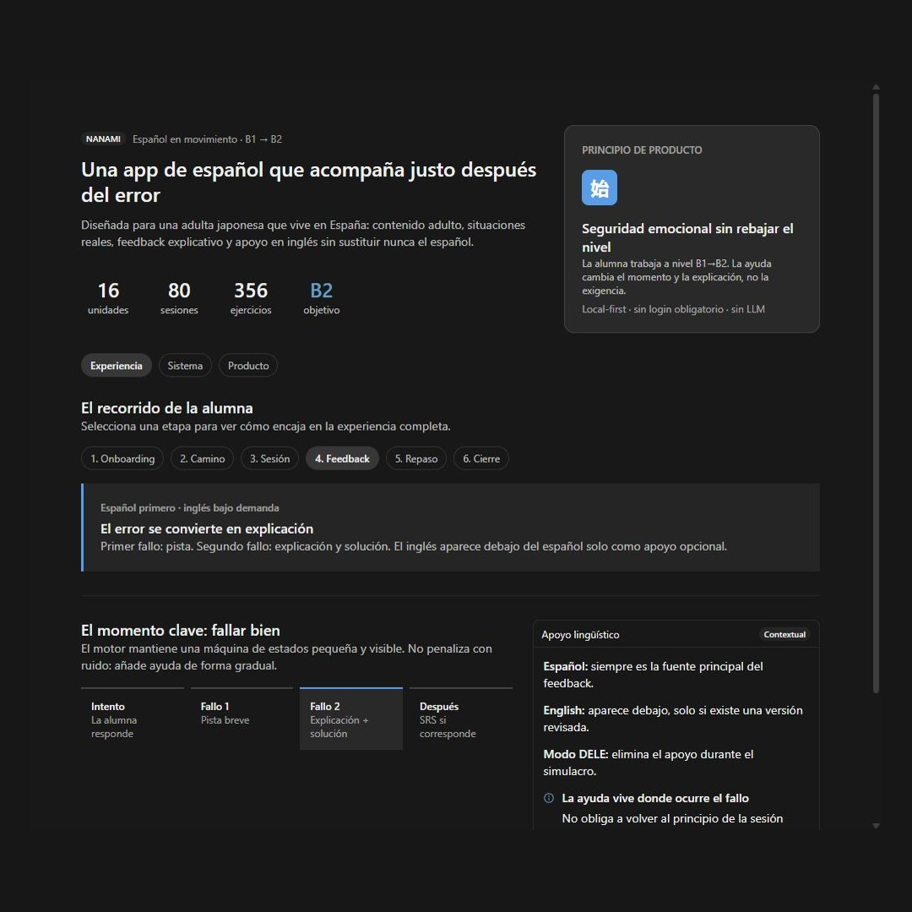

# Nanami — app de español (B1→B2)

<p align="center">
  <a href="https://espanol-app-five.vercel.app">
    
  </a>
</p>

<p align="center">
  <a href="https://espanol-app-five.vercel.app"><strong>🚀 Ver la app en vivo</strong></a>
</p>

[▶ Ver el vídeo del MVP](docs/brag/2026-10-12-canvas-explainer/brag.mp4)

Aplicación de aprendizaje de español para hablantes de japonés. Primera usuaria: adulta japonesa en España, nivel B1 → objetivo B2. **MVP en revisión**: funcional de extremo a extremo, quedan ajustes y validación humana antes de darlo por cerrado del todo.

**Para el contexto operativo completo (reglas, fuentes de verdad, estado, decisiones ya cerradas), lee [`CLAUDE.md`](./CLAUDE.md) antes de tocar nada.**

## Reparto de trabajo
- **Claude Code** → contenido pedagógico (currículo, unidades, ejercicios).
- **Producto** → UX/UI, lesson engine, progreso, persistencia, arquitectura de código.

## Dónde está cada cosa
- `content/curriculo-b1-b2.md` — currículo completo, 16 unidades B1→B2 (fuente de verdad del contenido). No lo edites a mano; si hace falta cambiar algo, pídeselo a Claude Code.
- `docs/decisions/` — registro fechado de decisiones de arquitectura. No se editan; se añade un archivo nuevo con fecha.
- `src/` — código de producto.
- `tools/parse-curriculo/` — parser markdown → JSON en `public/data/` (generado, no se commitea).

## Cómo arrancar
```
pnpm install
pnpm dev
```
`pnpm dev` y `pnpm build` parsean las 16 unidades antes de arrancar (`predev` / `prebuild`). No hace falta un `pnpm parse` manual. El JSON vive en `public/data/` y está en `.gitignore` porque se deriva del markdown.

```
pnpm test
pnpm parse --unit B1-B2-U01   # opcional: una sola unidad
```

El progreso de ejercicios se guarda en IndexedDB de este navegador. El perfil de onboarding va en localStorage. En `/perfil` se exporta e importa una copia JSON.

## Estado
- Currículo B1→B2 completo (16/16 unidades) + Categoría A/B.
- Fases 0–2 hechas: parser, onboarding/camino, motor interactivo de U1 S1 (emparejar, opción múltiple, clasificar).
- Cimientos de persistencia, validadores testeables y outline de sesión derivado del markdown.
- Siguiente: Fase 3 (resto de tipos de ejercicio, audio, SRS) — trabajo de producto; el contenido ya está en el currículo.

## Futuro
Escalar a A1–C2 (contenido pendiente; fuera del MVP). Login opcional para sync entre dispositivos (V2).
